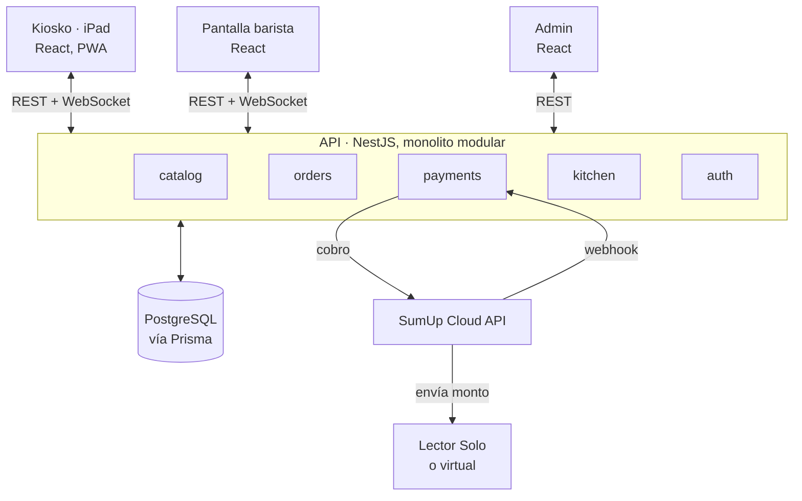

# Arquitectura, API y pagos

## 7. Integración de pago con SumUp

El patrón de The Coffee (la tablet crea el cobro y el monto aparece solo en el terminal) corresponde a la **Cloud API de SumUp con el lector Solo**. Esa API permite iniciar un cobro desde un punto de venta en cualquier plataforma, web incluida, siempre que pueda enviar peticiones HTTPS ([SumUp Cloud API](https://developer.sumup.com/terminal-payments/cloud-api)). El Solo está disponible en Chile ([SumUp Solo](https://developer.sumup.com/terminal-payments/readers/solo/)).

**Cómo funciona**

1. **Emparejar (una vez):** el Solo, con la sesión cerrada, genera un código de emparejamiento que dura 5 minutos. El backend lo envía a la API y recibe un `readerId`.
2. **Crear el cobro:** el backend llama a `POST /v0.1/merchants/{merchantCode}/readers/{readerId}/checkout` con el monto y un `return_url`.
3. **No asumir éxito:** la respuesta solo confirma que el terminal aceptó la orden de cobro. El pedido sigue en `PENDING_PAYMENT` y se guarda el `client_transaction_id`.
4. **Recibir el resultado:** cuando la transacción termina, SumUp envía un webhook al `return_url` con estado `successful` o `failed`. El backend actualiza el pedido y avisa al kiosko y al barista por WebSocket.
5. **Cancelar:** `POST …/readers/{readerId}/terminate` solo funciona mientras el terminal espera la tarjeta. Si funciona, llega como un webhook con estado `failed`.

**Detalles que importan**

- Tras aceptar un cobro, el terminal tiene 60 segundos para iniciarlo y rechaza otros cobros en ese lapso.
- El texto de `failure_reason` es libre: no se compara contra strings ni se muestra al cliente.
- Se necesita una **Affiliate Key** para la app, además de la API key del comercio.
- El `return_url` debe ser HTTPS y público. En desarrollo se expone el backend local con un túnel (ngrok o Cloudflare Tunnel).

**Estrategia en tres niveles**

| Nivel | Proveedor                                                      | Para qué                                                                                        | Costo             |
| ----- | -------------------------------------------------------------- | ----------------------------------------------------------------------------------------------- | ----------------- |
| 1     | `FakePaymentProvider` propio                                   | Desarrollo diario y demo pública: aprueba o rechaza según el monto, con un retardo configurable | $0                |
| 2     | SumUp sandbox + [Virtual Solo](https://virtual-solo.sumup.com) | Probar la integración real sin hardware; el PIN se aprueba siempre y no se mueve dinero         | $0                |
| 3     | SumUp Solo físico + cuenta de comercio                         | Validar con tarjeta real (opcional, al final)                                                   | Compra del lector |

Los tres implementan la misma interfaz `PaymentProvider` (`startCheckout`, `cancel`, `handleWebhook`). Este es el ejemplo más claro de modularidad del proyecto, y se nota en una entrevista.

**Si el webhook nunca llega:** el backend guarda la hora en que inició cada cobro. Si pasados 90 segundos el pago sigue `PENDING`, consulta el estado de esa transacción en SumUp y lo resuelve; si SumUp tampoco responde, el pedido queda en `PAYMENT_FAILED` y el kiosko vuelve al resumen. Así ningún pedido queda colgado para siempre.

Vigente al Nov 17, 2026, según la documentación de SumUp; revisar si cambió antes de implementar.

## 8. Arquitectura y stack

Un **monolito modular**: un solo backend dividido en módulos de dominio, y tres frontends React que comparten tipos con él. Es más simple que microservicios y más ordenado que un backend de una sola carpeta.



Solo el módulo `payments` habla con SumUp; cambiarlo por el simulador no toca al resto del sistema.

**Decisión: PWA y no app nativa.** El iPad nunca habla directo con el lector SumUp: el cobro lo inicia el backend por la Cloud API. Como el kiosko solo muestra pantallas y recibe eventos, una web instalada basta. Desde iPadOS 26, todo sitio agregado a la pantalla de inicio abre como web app sin la interfaz de Safari ([WebKit](https://webkit.org/?p=16993)), y desde iOS 18.4 las web apps instaladas pueden mantener la pantalla encendida con Screen Wake Lock ([Monterail](https://www.monterail.com/blog/pwa-for-apple-ios)). Si más adelante se necesita una app nativa, la misma app de React se empaqueta con Capacitor, sin reescribirla.

**Decisión: sesiones en la base de datos y no JWT.** Hay tres identidades distintas: el admin (correo y contraseña), el barista (PIN en una pantalla compartida) y los dispositivos (token propio, sin persona detrás). Admin y barista reciben un identificador aleatorio en una cookie `httpOnly`, `Secure` y `SameSite=Lax`, y la sesión vive en la tabla `Session`. Los dispositivos envían un token largo cuyo hash se guarda en `Device`. JWT era viable, pero revocar el acceso de un barista o de un iPad robado es borrar una fila, y con un solo backend no se necesita validar sin consultar la base. Contraseñas y PIN con argon2; máximo 5 intentos de PIN por minuto; las rutas se protegen con un guard de NestJS y `@Roles()`; Socket.IO valida la misma cookie o token al conectar.

**Decisión: PostgreSQL + Prisma y backend propio, no Supabase completo.** Supabase genera la API, el login y el tiempo real, que es justo lo que este proyecto quiere aprender a construir. En desarrollo, PostgreSQL corre en Docker; en la demo pública, Supabase o Neon se usan solo como hosting de PostgreSQL mediante `DATABASE_URL`. Cambiar de proveedor es cambiar esa variable.

| Capa               | Tecnología                                                                            | Por qué                                                                                       |
| ------------------ | ------------------------------------------------------------------------------------- | --------------------------------------------------------------------------------------------- |
| Lenguaje           | TypeScript en todo el proyecto                                                        | Un lenguaje, tipos compartidos entre front y back                                             |
| Frontend           | React + Vite                                                                          | Lo que quieres aprender; Vite da un entorno rápido                                            |
| Ruteo              | React Router                                                                          | Pantallas del kiosko, del barista y del admin                                                 |
| Datos del servidor | TanStack Query                                                                        | Caché, recargas y estados de carga sin código repetido                                        |
| Estado local       | Zustand                                                                               | El carro del kiosko, simple y sin ceremonia                                                   |
| UI                 | Tailwind CSS + shadcn/ui                                                              | Look minimalista rápido; componentes accesibles                                               |
| Backend            | Node + NestJS                                                                         | Te obliga a ordenar en módulos, controladores y servicios; es muy pedido en ofertas laborales |
| Validación         | Zod (esquemas compartidos)                                                            | Mismo esquema valida el formulario y la API                                                   |
| Base de datos      | PostgreSQL + Prisma                                                                   | Relacional como el dominio; migraciones versionadas                                           |
| Tiempo real        | Socket.IO                                                                             | Pedidos al barista y estado del pago al kiosko                                                |
| Auth               | Sesiones en PostgreSQL con cookie httpOnly; token de dispositivo para kiosko y cocina | Se revocan al instante; con un solo backend no hace falta JWT                                 |
| Infraestructura    | Docker Compose, GitHub Actions                                                        | Levantar todo con un comando; CI en cada push                                                 |

**Estructura del repositorio** (monorepo con pnpm workspaces)

```
cafe-kiosk/
├─ apps/
│  ├─ api/          NestJS: modules/catalog, orders, payments, kitchen, auth
│  ├─ kiosk/        React: pantalla del cliente (iPad)
│  ├─ kitchen/      React: pantalla del barista
│  └─ admin/        React: backoffice
├─ packages/
│  ├─ shared/       Tipos, esquemas Zod, reglas de precio y estados
│  └─ ui/           Componentes visuales compartidos
├─ docs/           Este documento, ADRs, diagramas
└─ docker-compose.yml
```

**Reglas de modularidad**

- Un módulo no lee las tablas de otro: le pide los datos a su servicio.
- `payments` no sabe qué es un café; solo cobra montos y emite eventos `payment.succeeded` / `payment.failed`.
- `orders` escucha esos eventos y cambia el estado del pedido; `kitchen` escucha `order.paid`.
- El cálculo de precios vive en `packages/shared`, así el kiosko muestra lo mismo que el backend cobra.

## 9. API y eventos en tiempo real

REST para leer y escribir; WebSocket solo para avisar cambios. Prefijo `/api/v1`. La especificación completa se genera con OpenAPI (Swagger) desde NestJS.

**Endpoints principales**

| Método | Ruta                                                               | Quién           | Para qué                                                        |
| ------ | ------------------------------------------------------------------ | --------------- | --------------------------------------------------------------- |
| GET    | `/menu`                                                            | Kiosko          | Catálogo activo completo (categorías, productos, modificadores) |
| POST   | `/orders`                                                          | Kiosko          | Crear pedido desde el carro; el backend recalcula el total      |
| POST   | `/orders/:id/pay`                                                  | Kiosko          | Iniciar el cobro en el proveedor configurado                    |
| POST   | `/orders/:id/cancel-payment`                                       | Kiosko          | Cancelar mientras el terminal espera                            |
| GET    | `/orders/:id`                                                      | Kiosko          | Estado actual (respaldo si se pierde el WebSocket)              |
| POST   | `/webhooks/sumup`                                                  | SumUp           | Resultado final del cobro                                       |
| GET    | `/kitchen/orders?status=`                                          | Barista         | Cola de pedidos activos                                         |
| PATCH  | `/kitchen/orders/:id/status`                                       | Barista         | Avanzar el estado                                               |
| POST   | `/auth/login` · `/auth/pin`                                        | Admin · Barista | Iniciar sesión                                                  |
| CRUD   | `/admin/categories` · `/admin/products` · `/admin/modifier-groups` | Admin           | Mantener el menú                                                |
| PATCH  | `/admin/products/:id/sold-out`                                     | Admin           | Marcar agotado                                                  |

**Endpoints de administración que faltaban**

| Método | Ruta                             | Para qué                                                                     |
| ------ | -------------------------------- | ---------------------------------------------------------------------------- |
| GET    | `/admin/orders?date=`            | Pedidos del día con su estado (pantalla "Pedidos de hoy")                    |
| POST   | `/admin/devices`                 | Registrar un kiosko o una pantalla de cocina; devuelve su token una sola vez |
| DELETE | `/admin/devices/:id`             | Revocar un dispositivo (iPad perdido o reemplazado)                          |
| POST   | `/admin/devices/:id/pair-reader` | Emparejar un lector SumUp con ese kiosko usando el código del Solo           |
| CRUD   | `/admin/users`                   | Crear baristas, cambiar su PIN, desactivarlos                                |
| POST   | `/devices/heartbeat`             | Latido del dispositivo cada 30 s (estado "en línea")                         |

**Eventos WebSocket (servidor → cliente)**

| Evento                 | Sala                    | Datos                            | Quién lo usa                                          |
| ---------------------- | ----------------------- | -------------------------------- | ----------------------------------------------------- |
| `payment.updated`      | `order:{id}`            | orderId, status, motivo genérico | Kiosko: pasa a "aprobado" o "rechazado"               |
| `order.paid`           | `kitchen`               | Pedido completo con ítems        | Barista: nueva tarjeta en "Nuevos"                    |
| `order.status_changed` | `kitchen`, `order:{id}` | orderId, status                  | Barista y pantalla de retiro                          |
| `menu.changed`         | `kiosk`                 | —                                | Kiosko: vuelve a pedir `/menu` (ej. producto agotado) |

**Ejemplo de creación de pedido**

```json
POST /api/v1/orders
{
  "customerName": "Deivit",
  "orderType": "TAKEAWAY",
  "items": [
    { "productId": "latte", "quantity": 1, "optionIds": ["size-grande", "milk-avena"], "note": "bien caliente" },
    { "productId": "croissant", "quantity": 2, "optionIds": [] }
  ]
}
```

El cliente nunca envía precios: solo IDs. El backend busca los precios vigentes, valida las reglas de cada grupo de modificadores y responde con el total.
