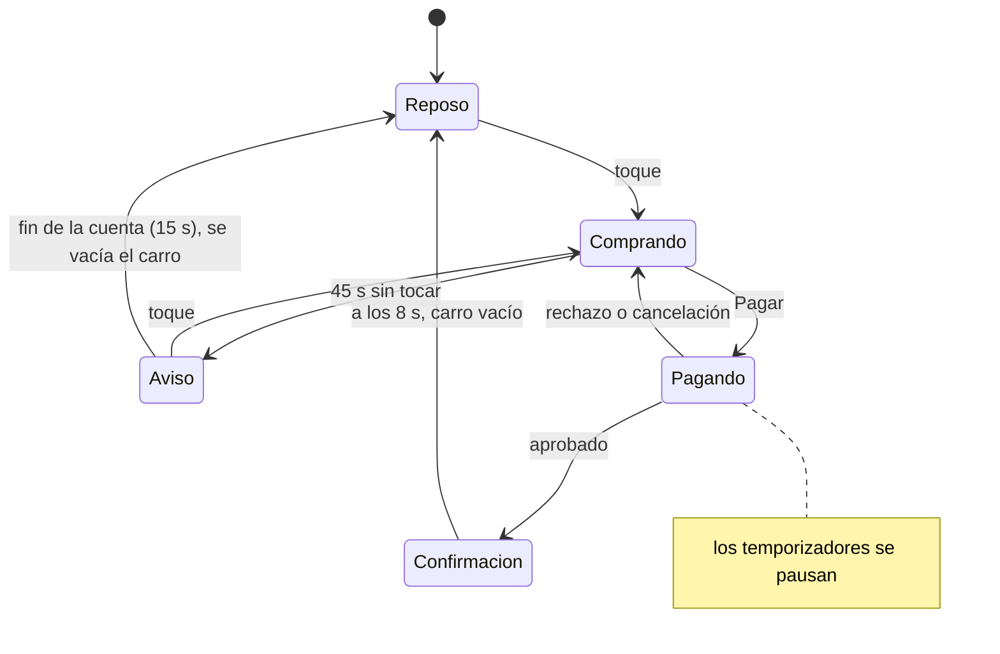

# Diseño UI/UX

## 10. Diseño UI/UX

El kiosko debe sentirse como The Coffee: pocas decisiones por pantalla, imágenes grandes, mucho espacio en blanco y una sola acción principal visible. Antes de programar, se dibujan los wireframes en Figma (gratis) o en papel.

**Principios**

- Una acción principal por pantalla, con un botón grande y de color fijo (ej. "Agregar — $3.900").
- El total del carro siempre visible en una barra inferior.
- Máximo 2 toques para llegar a cualquier producto.
- Opciones obligatorias preseleccionadas con su valor por defecto (ej. leche entera).
- Paleta de 2 colores + neutros; una tipografía; sin sombras pesadas.
- Feedback inmediato en cada toque (estado presionado, animación corta al agregar al carro).

**Pantallas del kiosko**

| #   | Pantalla               | Contenido clave                                                                                                                                                                                                     |
| --- | ---------------------- | ------------------------------------------------------------------------------------------------------------------------------------------------------------------------------------------------------------------- |
| K1  | Reposo                 | Producto destacado a pantalla completa con su nombre y el botón "Iniciar"; arriba logo, "Formas de pago" e "Idioma"                                                                                                 |
| K2  | Categorías             | Grilla de íconos de línea con nombre y bajada corta; carro y total abajo a la izquierda                                                                                                                             |
| K3  | Productos              | Íconos de categoría arriba; fila de subcategorías que sigue al carrusel; cada producto con imagen, nombre, precio, caliente o frío y tamaño; carro abajo a la izquierda y "Finalizar" abajo a la derecha (ver 10.2) |
| K4  | Detalle de producto    | Nombre a la izquierda; descripción y tamaño arriba; grupos de modificadores en columnas, cada uno con su ícono; nota libre; cantidad; "Agregar" con el precio                                                       |
| K5  | Consumir aquí o llevar | Dos botones grandes y nada más                                                                                                                                                                                      |
| K6  | Nombre                 | "Te llamaremos por tu nombre (o apodo)", campo con teclado en pantalla, "Ok"                                                                                                                                        |
| K7  | Resumen y pago         | Pantalla dividida. Izquierda: pedido editable, sugeridos con botón "+" y "Agregar más productos". Derecha: total grande, "Pagar", tipo de consumo (se puede cambiar), "Formas de pago" y vaciar pedido              |
| K8  | Pagando                | Monto, dibujo del terminal, estado en vivo y "Cancelar" mientras espera la tarjeta                                                                                                                                  |
| K9  | Resultado              | Aprobado: agradecimiento, nombre grande, número de pedido y "Hacer un nuevo pedido". Rechazado: mensaje claro y vuelta a K7                                                                                         |

**Patrones que se repiten en todas las pantallas:** el botón principal es siempre negro, tipo píldora y va abajo a la derecha ("Iniciar", "Finalizar", "Agregar", "Pagar"); el carro con su contador y el total van siempre abajo a la izquierda; categorías y modificadores usan íconos de línea del mismo estilo.

**Diseño de todas las pantallas:** [lienzo de pantallas](https://claude.ai/artifact/KJppSFeQ8cbSgRUcWQ9SYH), con el prototipo navegable del kiosko (K1 a K9 y estados especiales), la pantalla del barista y el admin. Pendientes de diseñar, por ser CRUD simples: "Pedidos de hoy", "Dispositivos" y "Usuarios" del admin.

### 10.1 Ciclo de vida del kiosko

El kiosko nunca se apaga ni se sale de la app, y después de cada cliente vuelve solo a la pantalla de reposo. Esto se logra en tres capas: el hardware lo mantiene cargado, el iPad lo bloquea en la app y la app se reinicia sola.

| Capa     | Qué se configura                                                                                                                                                           | Para qué                                                                 |
| -------- | -------------------------------------------------------------------------------------------------------------------------------------------------------------------------- | ------------------------------------------------------------------------ |
| Hardware | Soporte fijo para el iPad con el cargador siempre conectado y el cable oculto                                                                                              | Batería siempre llena; nadie se lleva ni desenchufa la tablet            |
| iPadOS   | Bloqueo automático en "Nunca" (Ajustes → Pantalla y brillo); Acceso Guiado con código y los botones físicos desactivados; modo Concentración para silenciar notificaciones | Que el cliente no pueda salir de la app ni ver notificaciones personales |
| App      | Screen Wake Lock, pantalla de reposo, temporizadores de inactividad, reinicio automático, gestos bloqueados, reconexión                                                    | Que cada cliente encuentre el kiosko limpio y funcionando                |

Durante el pago los temporizadores se pausan: el cliente puede estar buscando su tarjeta, y el cobro tiene su propia ventana de 60 segundos en SumUp. Si el pago se rechaza, vuelve al carro con todo lo que eligió.

**Pantalla de reposo (salvapantallas)**

- El producto destacado que elige el admin (por ejemplo, la bebida de temporada) a pantalla completa, con su nombre y el botón "Iniciar". Si hay varios destacados, rotan con una transición suave.
- Toda la pantalla responde al toque, no solo un botón.
- El movimiento constante evita que la imagen quede marcada en pantallas OLED y atrae la mirada de quien pasa.
- Arriba, una franja fina con el logo, "Formas de pago" e "Idioma".

**Robustez: que nunca quede "muerto"**

- **Sin conexión:** se muestra encima "Volvemos en un momento", se bloquea el pago y la app reintenta sola cada pocos segundos. Al reconectar, vuelve a pedir el menú.
- **Latido:** cada 30 s el kiosko avisa al backend que está vivo; el admin ve "en línea" o "desconectado" por dispositivo.
- **Actualizaciones:** si hay una versión nueva desplegada, el kiosko recarga solo, pero únicamente mientras está en reposo, nunca a mitad de un pedido. También recarga una vez de madrugada para limpiar memoria.
- **Errores inesperados:** un límite de errores de React (error boundary) muestra "Algo salió mal" y vuelve a reposo en 5 s, en vez de dejar la pantalla en blanco.
- **Salida para el personal:** mantener presionado el logo 5 s y escribir un PIN abre un menú técnico (recargar, ver estado de conexión, ID del dispositivo). Para salir del todo de la app se usa el código del Acceso Guiado.
- **Privacidad:** al volver a reposo se borran el carro y el nombre del cliente anterior.

**Requerimientos del kiosko**

| ID        | Requerimiento                                                                                                                     | Prioridad |
| --------- | --------------------------------------------------------------------------------------------------------------------------------- | --------- |
| RF-KIO-01 | El kiosko arranca en reposo con el producto destacado y pasa a las categorías al tocar "Iniciar" o cualquier parte de la pantalla | M         |
| RF-KIO-02 | Tras 45 s sin toques en el menú o el carro, muestra "¿Sigues ahí?" con una cuenta de 15 s                                         | M         |
| RF-KIO-03 | Al terminar la cuenta, vacía el carro y vuelve a reposo                                                                           | M         |
| RF-KIO-04 | Los temporizadores se pausan mientras el pago está en curso                                                                       | M         |
| RF-KIO-05 | La confirmación del pedido vuelve a reposo a los 8 s                                                                              | M         |
| RF-KIO-06 | Sin conexión, se muestra un aviso y se bloquea el pago hasta reconectar                                                           | M         |
| RF-KIO-07 | Un error inesperado muestra un aviso y vuelve a reposo, nunca una pantalla en blanco                                              | M         |
| RF-KIO-08 | Se bloquean el zoom, la selección de texto y el arrastre que recarga la página                                                    | M         |
| RF-KIO-09 | Menú técnico oculto protegido por PIN                                                                                             | D         |
| RF-KIO-10 | Latido cada 30 s y estado "en línea" del dispositivo en el admin                                                                  | D         |
| RF-KIO-11 | Recarga automática en reposo al detectar una versión nueva                                                                        | D         |
| RF-KIO-12 | Los tiempos (45 s, 15 s, 8 s) se configuran desde el admin                                                                        | D         |

En código, este ciclo de vida es una máquina de estados explícita en el kiosko, por ejemplo con XState o con un `useReducer` y un tipo de TypeScript por estado. Así el kiosko nunca queda en un estado imposible, como pagando con el carro vacío.

### 10.2 Navegación del menú (K2)

El menú tiene dos niveles. Primero el cliente elige una categoría en la grilla de íconos (K2). Dentro de ella, los productos van en un solo carrusel horizontal agrupado por subcategorías; por ejemplo, en "Bebidas de autor": Calientes, Frías, Frappés. Arriba hay íconos para cambiar de categoría y, debajo, una fila de subcategorías que se marca sola al deslizar y sirve para saltar.

> Boceto de esta pantalla (K3): ver el [lienzo de pantallas](https://claude.ai/artifact/KJppSFeQ8cbSgRUcWQ9SYH). Capturas en `docs/design/`.

**Comportamiento**

- Cada subcategoría es una sección con su título y sus productos; las secciones van una al lado de la otra en el mismo carrusel.
- Al soltar el dedo, el carrusel se detiene alineado al inicio de un producto, sin quedar a medio camino.
- Cuando una subcategoría ocupa la mayor parte de la pantalla, su etiqueta se marca y la fila se desplaza para mantenerla a la vista.
- Tocar una subcategoría desliza el carrusel hasta ella; tocar un ícono de categoría cambia de categoría y vuelve al inicio.
- **Agregar nunca saca al cliente de donde estaba:** al tocar "Agregar" en el detalle, vuelve al carrusel en la misma posición y el carro se actualiza con una animación corta. El carro nunca se abre solo.
- El dibujo de abajo usa productos de ejemplo de una cafetería ficticia.

**Cómo se construye en React**

| Pieza                              | Técnica                                                                                                                                                                     |
| ---------------------------------- | --------------------------------------------------------------------------------------------------------------------------------------------------------------------------- |
| Carrusel                           | Un contenedor con `overflow-x: auto` y `scroll-snap-type: x mandatory`; cada columna con `scroll-snap-align: start`. Es CSS nativo, fluido en Safari y sin librerías        |
| Detectar la subcategoría visible   | `IntersectionObserver` sobre cada sección, con el contenedor del carrusel como raíz; la sección con mayor área visible pasa a ser la activa en el estado                    |
| Saltar al tocar una pestaña        | Una `ref` por sección y `scrollTo({ left, behavior: 'smooth' })`. Mientras dura el salto se pausa el observador, para que la barra no parpadee entre categorías intermedias |
| Mantener la pestaña activa visible | `scrollIntoView({ inline: 'center' })` sobre la pestaña cuando cambia la categoría activa                                                                                   |
| Componentes                        | `CategoryTabs`, `MenuCarousel`, `CategorySection`, `ProductCard` y un hook `useActiveCategory` que encapsula el observador                                                  |

**Requerimientos de navegación**

| ID        | Requerimiento                                                                                                                           | Prioridad |
| --------- | --------------------------------------------------------------------------------------------------------------------------------------- | --------- |
| RF-NAV-01 | Dentro de una categoría, los productos de todas sus subcategorías van en un solo carrusel horizontal, en el orden definido por el admin | M         |
| RF-NAV-02 | La fila de subcategorías marca la subcategoría visible mientras el cliente desliza                                                      | M         |
| RF-NAV-03 | Tocar una subcategoría desliza el carrusel hasta ella; tocar un ícono de categoría cambia de categoría                                  | M         |
| RF-NAV-04 | El carrusel se alinea a una columna al soltar el dedo                                                                                   | M         |
| RF-NAV-05 | La pestaña activa siempre queda visible en la barra, aunque haya muchas categorías                                                      | D         |
| RF-NAV-06 | Al volver de un producto o del carro, el carrusel conserva la posición donde estaba el cliente                                          | D         |

### 10.3 Detalle de producto (K4)

Todo se decide en una sola pantalla, sin pasos: cada grupo de modificadores es una columna con su ícono, y las opciones obligatorias vienen preseleccionadas, así que un cliente apurado puede tocar "Agregar" de inmediato.

> Boceto de esta pantalla (K4): ver el [lienzo de pantallas](https://claude.ai/artifact/KJppSFeQ8cbSgRUcWQ9SYH). Capturas en `docs/design/`.

- **El botón muestra cantidad y precio:** "Agregar 2 · $8.200" se recalcula con cada opción y con el selector −/+ (precio unitario con opciones × cantidad).
- **Cantidad 2 es una sola línea en el carro,** con cantidad 2, no dos líneas. En el resumen (K7) se puede cambiar la cantidad.
- **Si el cliente agrega otra vez el mismo producto con las mismas opciones y la misma nota,** se suma a la línea existente. Si cambia cualquier opción, es una línea nueva: un latte con avena y otro con leche entera son dos líneas.
- **Grupos de nivel:** "Vainilla: menos, medio, más" es un grupo de selección única como cualquier otro; el modelo de datos ya lo soporta sin cambios.
- **La nota es opcional,** de máximo 80 caracteres, y aparece en la pantalla del barista.

| ID        | Requerimiento                                                                                                                 | Prioridad |
| --------- | ----------------------------------------------------------------------------------------------------------------------------- | --------- |
| RF-DET-01 | El detalle muestra los grupos de modificadores en columnas, con las opciones obligatorias preseleccionadas                    | M         |
| RF-DET-02 | El selector −/+ define cuántas unidades iguales se agregan (mínimo 1, máximo 10)                                              | M         |
| RF-DET-03 | El botón "Agregar" muestra la cantidad y el precio total, recalculados en vivo                                                | M         |
| RF-DET-04 | Un producto idéntico (mismas opciones y nota) se suma a la línea existente del carro; si cambia algo, se crea una línea nueva | M         |
| RF-DET-05 | Nota libre opcional de hasta 80 caracteres por línea                                                                          | M         |

**Pantalla del barista:** tablero de 3 columnas (Nuevos, Preparando, Listos) con tarjetas grandes, legibles a 1 metro, y tiempo transcurrido que cambia de color si pasa de 5 minutos.

**Admin:** diseño funcional y estándar (tablas y formularios de shadcn/ui); aquí no se busca originalidad.
